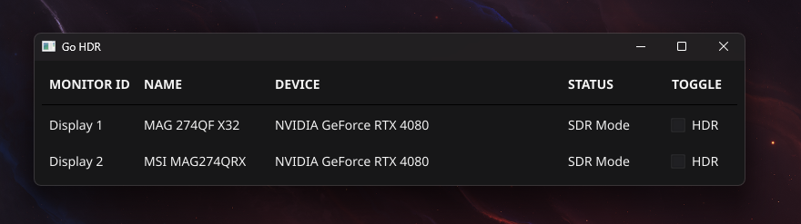

# Go HDR

> **Personal Utility:** A lightweight desktop tool built to toggle HDR mode per monitor on Windows to scratch my own hardware itch.

A desktop utility built with Go and Fyne to toggle HDR mode on individual monitors.

I threw this together because existing apps were not quite right for me.

## Features

Per-Monitor Controls: Detects active physical displays along with their attached GPU / Video Card details.

Instant HDR Toggling: Quick checkbox controls to switch between SDR and HDR modes on the fly.

## Getting Started

Prerequisites
Windows 10/11 (with HDR-capable displays)

Go 1.21+

make (via MinGW, WSL, or Git Bash)

### Running & Building

Use the included Makefile targets for easy development and compilation:

#### Setup dependencies

`make setup`

#### Build the Windows executable

`make build-win`

#### Or build and run

`make build-run`

#### Clean build artifacts

`make clean`

#### Linux TODO

`Not yet implemented`

## TODO

- Output whether HDR supported (and prevent toggling)
- Proactively check HDR State when viewing the APP to detect changes accurately
- Test on other setups/windows variants as windows seems incredibly janky with how hdr is reported
